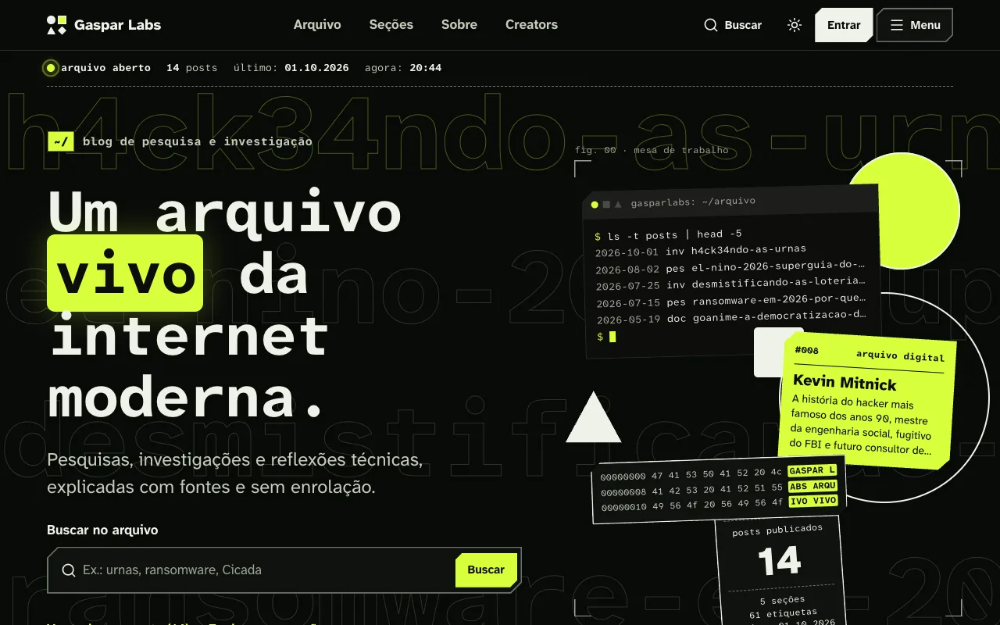
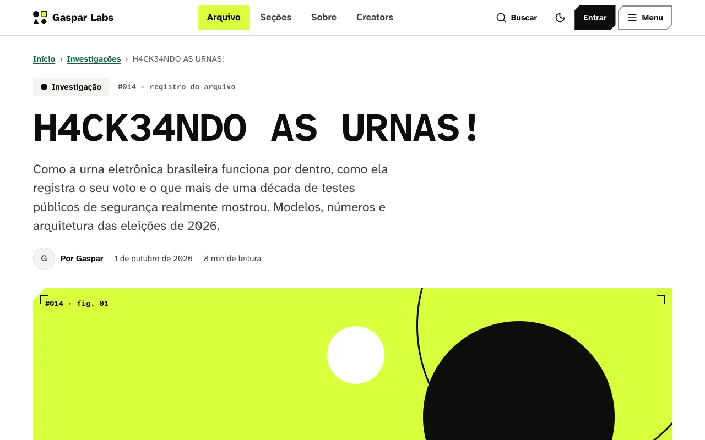
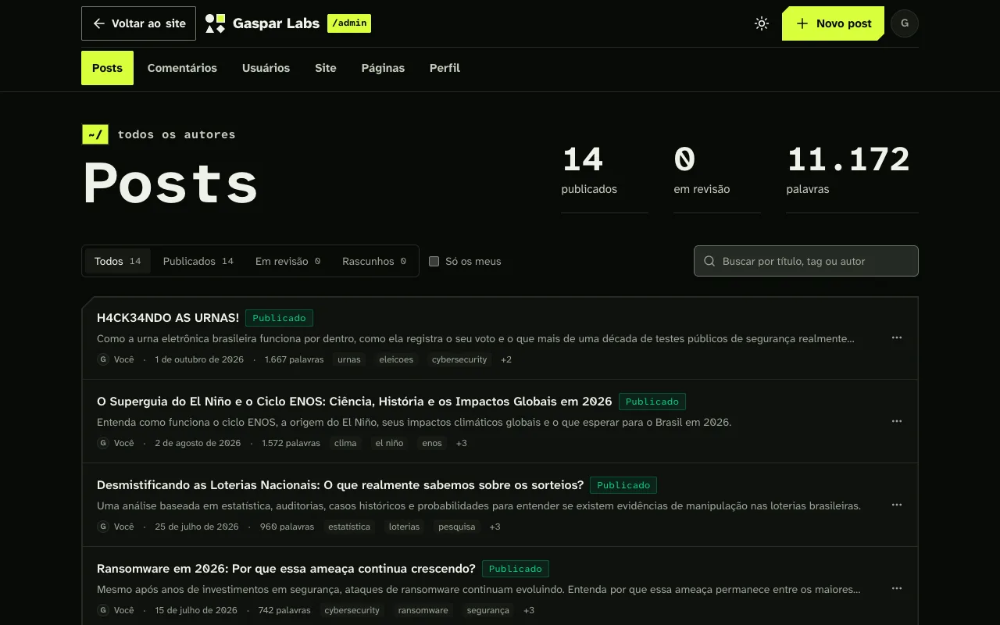

# Gaspar Labs

[](https://github.com/gasparzeon/gasparz1/actions/workflows/ci.yml)
[](LICENSE)
[](https://nextjs.org)
[](CONTRIBUTING.md#acessibilidade)
[](CONTRIBUTING.md)

Um arquivo vivo da internet moderna: blog de pesquisa e investigação sobre
segurança, sistemas e cultura digital, com painel próprio para vários autores.
Código aberto, acessível (WCAG 2.2 AA, verificado com axe) e pronto para rodar
no seu computador em cinco minutos, sem instalar banco de dados.

**No ar:** [gaspar.vorn.fun](https://gaspar.vorn.fun)



## Sumário

-   [Destaques](#destaques)
-   [Começo rápido](#começo-rápido)
-   [Testes](#testes)
-   [Comandos](#comandos)
-   [Como o código está organizado](#como-o-código-está-organizado)
-   [Tecnologias](#tecnologias)
-   [Como contribuir](#como-contribuir)
-   [Filosofia](#filosofia)
-   [Licença](#licença)
-   [Veja também](#veja-também)

## Destaques

-   **Leitura em primeiro lugar.** Fonte Atkinson Hyperlegible, tema escuro
    (padrão) e claro, tamanho do texto ajustável e índice lateral que mostra a
    parte do post e o tempo de leitura restante.
-   **Acessível de verdade.** WCAG 2.2 AA conferido com axe a cada push, nos
    dois temas e no celular. Tudo funciona pelo teclado, com "Pular para o
    conteúdo", trilha "Você está em" e respeito ao "reduzir movimento".
-   **Movimento com GSAP.** Títulos que se decodificam, paralaxe e um letreiro
    com pausa. O leitor desliga as animações com um botão.
-   **Arquivo com seções.** Investigações, pesquisas, arquivos digitais,
    reflexões técnicas e cultura, com busca sem acentos, filtros e atalho
    `Ctrl+K`.
-   **Painel para vários autores.** Editor Markdown com prévia, mídia,
    revisão, seis papéis, comentários moderados e o site inteiro editável, sem
    mexer no código.
-   **Creators.** Cada autor tem página com redes sociais (Spotify, X,
    Facebook, TikTok e Instagram) e um README curto escrito por ele.
-   **Seguro por padrão.** Login OAuth 2.0 com PKCE, senhas com scrypt,
    Markdown sanitizado e `eslint-plugin-security` sem tolerância a avisos.
-   **Sem configuração para começar.** Postgres embutido (PGlite) no
    desenvolvimento; Postgres de verdade em produção, na Vercel ou num
    servidor seu.





## Começo rápido

Em cerca de cinco minutos o site e o painel rodam no seu computador. Não é
preciso instalar banco de dados nem criar conta em serviço nenhum.

### O que você precisa

Confira no terminal se tem os três programas:

```shell
git --version   # qualquer versão recente
node -v         # v22 ou mais novo
pnpm -v         # 10 ou mais novo
```

Falta algum? No macOS, rode `brew install node pnpm`. No Linux e no Windows,
instale o Node pelo [site oficial do Node.js](https://nodejs.org) e depois
rode `npm install -g pnpm`.

### Passo a passo

1.  Baixe o código e entre na pasta:

    ```shell
    git clone https://github.com/gasparzeon/gasparz1.git
    cd gasparz1
    ```

1.  Instale as dependências. O comando termina com `Done in …`:

    ```shell
    pnpm install
    ```

1.  Crie o arquivo de configuração local. Ele guarda os segredos da sua
    máquina e nunca vai para o git:

    ```shell
    cp .env.example .env.local
    ```

1.  Gere a senha do painel. Digite uma senha com pelo menos 12 caracteres e
    confirme. Nada aparece na tela enquanto você digita, e isso é normal:

    ```shell
    pnpm admin:hash
    ```

    O comando imprime duas linhas. Abra o `.env.local` e cole cada uma no
    lugar da linha vazia de mesmo nome:

    ```shell
    ADMIN_PASSWORD_HASH=scrypt:131072:8:1:...
    AUTH_SECRET=...
    ```

    Guarde a senha que você digitou: só a versão embaralhada fica salva.

1.  Suba o site:

    ```shell
    pnpm dev
    ```

    Na primeira vez, o projeto cria o banco em `.data/pglite`, cria a conta
    do dono e importa os 14 posts de `content/posts/`. Espere aparecer
    `✓ Ready`.

1.  Abra [localhost:3000](http://localhost:3000) para ver o site.

1.  Para escrever, entre em [localhost:3000/admin](http://localhost:3000/admin)
    com o usuário `gaspar` (o `ADMIN_USERNAME` do `.env.local`) e a senha do
    passo 4.

Pronto. Para parar o servidor, use `Ctrl+C`. Se algo não funcionou, veja os
[problemas comuns](docs/problemas-comuns.md).

## Testes

```shell
pnpm test          # unitários (Jest, com mocks) e integração (Postgres em memória)
pnpm e2e:install   # uma vez só: baixa o Cypress (~500 MB)
pnpm e2e           # o site de verdade no Chrome, com verificação de acessibilidade
```

O `pnpm e2e` faz o build e sobe um servidor isolado na porta 3123, com banco
em memória e uma conta de teste própria. Ele não mexe no seu banco nem na sua
conta e pode rodar com o `pnpm dev` aberto. Para ver os testes rodando na
janela do Cypress, use `pnpm e2e:open`.

## Comandos

| Comando                             | Para quê                                                   |
| ----------------------------------- | ---------------------------------------------------------- |
| `pnpm dev`                          | site e painel em desenvolvimento, recarregando ao salvar   |
| `pnpm build` / `pnpm start`         | gera e roda a versão de produção                           |
| `pnpm test`                         | testes unitários e de integração                           |
| `pnpm test:unit` / `pnpm test:db`   | só os unitários / só os de integração                      |
| `pnpm test:watch`                   | testes unitários a cada alteração                          |
| `pnpm test:coverage`                | testes com relatório de cobertura em `coverage/`           |
| `pnpm e2e` / `pnpm e2e:open`        | testes de ponta a ponta (Cypress e axe)                    |
| `pnpm lint` / `pnpm lint:fix`       | ESLint com `eslint-plugin-security`, sem aceitar avisos    |
| `pnpm format` / `pnpm format:check` | Prettier                                                   |
| `pnpm typecheck`                    | confere os tipos do TypeScript (site e testes do Cypress)  |
| `pnpm admin:hash`                   | gera `ADMIN_PASSWORD_HASH` e `AUTH_SECRET`                 |
| `pnpm db:generate --name <nome>`    | cria uma migração a partir de `lib/db/schema.ts`           |
| `pnpm db:migrate`                   | aplica as migrações num Postgres (`DATABASE_URL`)          |
| `pnpm db:studio`                    | abre o Drizzle Studio para ver o banco                     |

## Como o código está organizado

```text
app/              rotas: site público, painel /admin e API (/api)
components/       interface do site (site/), do painel (admin/) e do Markdown
content/posts/    posts antigos em .mdx, importados na primeira execução
cypress/          testes de ponta a ponta e comandos próprios (axe, decodificação)
docs/             guias e imagens desta documentação
drizzle/          migrações SQL do banco
lib/auth/         servidor OAuth 2.0, sessões e permissões
lib/cms/          posts e mídia
lib/db/           schema, conexão e importação inicial
lib/markdown/     Markdown dos posts e do README dos autores (com sanitização)
lib/motion/       animações (GSAP) declaradas por atributos data-gz-*
lib/site/         configurações do site e páginas por blocos
lib/users/        contas, perfil, redes sociais e README
scripts/          senha do painel, migrações, testes e2e e ferramentas de post
test/helpers/     banco falso, APIs do navegador para o jsdom e utilitários
```

O visual fica em `app/site.css` (componentes `gz-*`) e `app/globals.css`
(temas). Os comentários do código, como este README, estão em português.

## Tecnologias

-   [Next.js 16](https://nextjs.org) (App Router e ISR), React 19 e
    TypeScript
-   [Tailwind CSS 4](https://tailwindcss.com) e [GSAP](https://gsap.com)
-   Postgres com [Drizzle ORM](https://orm.drizzle.team);
    [PGlite](https://pglite.dev) no desenvolvimento e nos testes
-   Markdown com unified, remark e rehype, Shiki e KaTeX
-   [Jest](https://jestjs.io), Testing Library, [Cypress](https://www.cypress.io)
    e [axe](https://github.com/dequelabs/axe-core)
-   CI no GitHub Actions e no Forgejo; deploy na Vercel ou num servidor seu

## Como contribuir

Toda ajuda é bem-vinda: um erro de digitação, um teste que falta, uma melhoria
de acessibilidade ou uma funcionalidade nova.

1.  Escolha algo para fazer. Veja as [issues abertas][issues] ou uma das
    ideias abaixo.
1.  Leia o [guia de contribuição](CONTRIBUTING.md): ambiente, convenções e o
    que o CI confere.
1.  Abra um pull request pequeno e focado, com o que mudou e como testar.

Ideias para uma primeira contribuição:

-   Mais redes no perfil dos autores, como GitHub, YouTube ou Bluesky
    (`lib/users/socials.ts` mostra o padrão, com testes prontos para copiar).
-   Testes para componentes que ainda não têm, em `components/`.
-   Melhorias nesta documentação ou nos [guias](docs/).

Nunca contribuiu com código aberto? Este projeto é um bom começo: os testes
mostram o que cada parte faz e o CI aponta o que falta antes da revisão.

## Filosofia

O Gaspar Labs não foi criado para produzir conteúdo rápido. A proposta é
construir arquivos digitais, pesquisas, investigações, reflexões técnicas e
documentação cultural da internet moderna: um laboratório sobre sistemas,
comportamento e tecnologia. O código segue a mesma ideia, com cuidado,
acessibilidade e sem atalhos.

## Licença

Distribuído sob a [licença MIT](LICENSE). Você pode usar, modificar e
distribuir o código, mantendo o aviso de copyright.

## Veja também

-   [Painel /admin](docs/painel.md): editor, site editável, usuários e papéis,
    Creators, comentários e login.
-   [Como publicar](docs/publicar.md): Markdown, imagens, vídeos e boas
    práticas para posts.
-   [Produção](docs/deploy.md): Vercel ou servidor próprio, passo a passo.
-   [Problemas comuns](docs/problemas-comuns.md): login, portas, build e
    banco.
-   [Guia de contribuição](CONTRIBUTING.md): fluxo, testes, acessibilidade e
    CI.

[issues]: https://github.com/gasparzeon/gasparz1/issues
